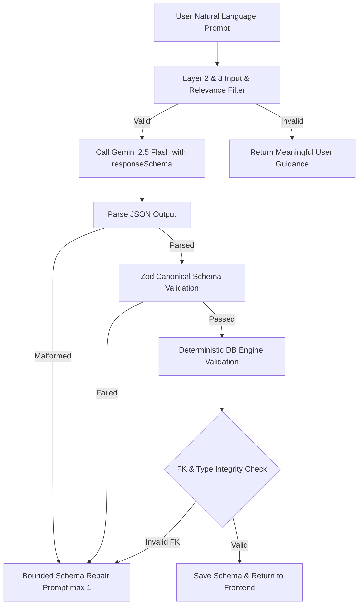

# AI_GENERATION.md — Gemini Integration & Schema Synthesis Pipeline

## 1. Model Configuration
- **Model**: `gemini-2.5-flash` (or user-configurable via `GEMINI_MODEL` env variable).
- **SDK**: Official `@google/genai` Node.js SDK.
- **Constraints**:
  - `responseMimeType: "application/json"`
  - `responseSchema`: Canonical Schema JSON Schema definition.
  - Temperature: `0.1` (deterministic, low hallucination, strict relational rigor).

## 2. Prompt Architecture

### 2.1 System Instruction
```markdown
You are a Principal Database Architect & Data Modeling Specialist.
Your task is to analyze the user's software requirements and synthesize a normalized, production-grade relational database schema.

CORE RULES:
1. Normalize to 3NF unless explicit denormalization is requested for performance.
2. Every entity MUST have a primary key (default to 'id uuid' or 'id serial/bigint').
3. For Many-to-Many relationships, ALWAYS create an explicit junction/association table with composite primary key or unique pair constraint.
4. Use standard SQL data types appropriate for the target dialect (e.g. PostgreSQL: uuid, varchar(N), text, integer, bigint, boolean, timestamp with time zone, numeric(10,2), jsonb).
5. All foreign keys must reference existing entities and primary key columns.
6. Clearly document any inferred assumptions in the 'assumptions' array.
7. If critical business logic is missing or ambiguous, formulate actionable questions in 'unresolvedQuestions'.
8. NEVER fabricate imaginary requirements or silent breaking constraints.
```

### 2.2 Structured Input Format
```json
{
  "applicationName": "Healthcare Clinic",
  "requirements": "...",
  "targetDialect": "postgresql",
  "suggestedEntities": ["patients", "doctors", "appointments"],
  "rules": ["Appointments cannot overlap for the same doctor"]
}
```

## 3. Multi-Stage Validation & Repair Pipeline



## 4. Deterministic Database Integrity Checks
1. **Primary Key Exists**: Every table must have >= 1 primary key field.
2. **Foreign Key Integrity**:
   - `sourceEntityId` and `targetEntityId` exist in `entities`.
   - `sourceFieldId` exists in source entity fields.
   - `targetFieldId` exists in target entity fields and is a primary key or unique column.
   - Data types of `sourceFieldId` and `targetFieldId` are compatible (e.g., `uuid` to `uuid`, `integer` to `integer`).
3. **Circular Cascade Check**: Detect mutually cascading delete cycles.
4. **Naming Uniqueness**: Table names and column names within each table must be unique.
