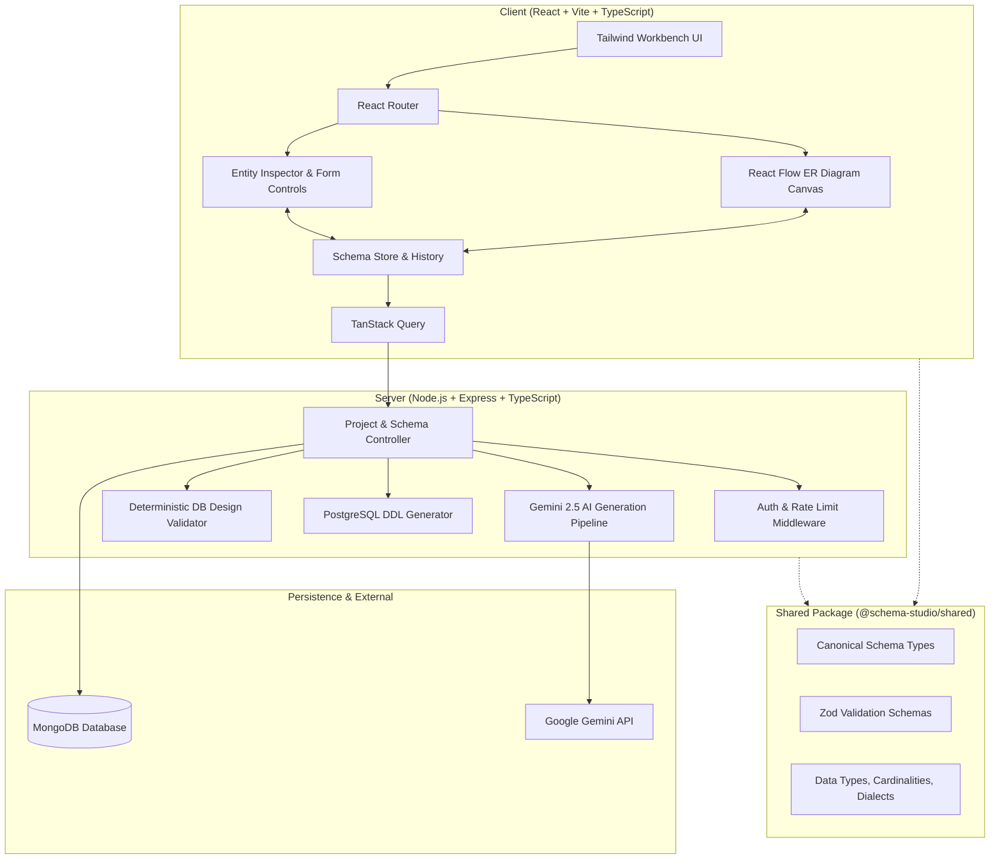

# ARCHITECTURE.md — System Architecture & Data Flow

## 1. System Overview



## 2. Directory Structure

```
ER/
├── AGENTS.md
├── RULES.md
├── package.json               # Root workspaces configuration
├── .env.example
├── docs/                      # Technical documentation
│   ├── PRODUCT_SPEC.md
│   ├── ARCHITECTURE.md
│   ├── IMPLEMENTATION_PLAN.md
│   ├── DATABASE_SCHEMA.md
│   ├── API_SPEC.md
│   ├── AI_GENERATION.md
│   ├── SECURITY.md
│   └── TESTING.md
├── shared/                    # Shared types & schemas
│   ├── package.json
│   ├── tsconfig.json
│   └── src/
│       ├── types/schema.ts
│       ├── schemas/validation.ts
│       └── utils/defaults.ts
├── server/                    # Node.js + Express + TS Backend
│   ├── package.json
│   ├── tsconfig.json
│   └── src/
│       ├── config/
│       ├── middleware/
│       ├── services/
│       │   ├── ai.service.ts
│       │   ├── schema-validator.service.ts
│       │   └── sql-generator.service.ts
│       ├── controllers/
│       ├── routes/
│       ├── db/
│       └── index.ts
└── client/                    # Vite + React + TS Frontend
    ├── package.json
    ├── vite.config.ts
    ├── tsconfig.json
    ├── tailwind.config.js
    └── src/
        ├── components/
        │   ├── canvas/        # React Flow custom nodes & edges
        │   ├── workbench/     # Panels, toolbar, inspector
        │   ├── common/        # Buttons, inputs, modals, toasts
        │   └── landing/       # Marketing & demo components
        ├── pages/
        ├── hooks/
        ├── services/api.ts
        ├── store/
        └── App.tsx
```

## 3. Data Flow

1. **Requirement Submission**:
   - User inputs natural language specification in the Requirement Workspace.
   - Frontend performs preliminary character length and field format checks.
   - Request dispatched to `POST /api/projects/:id/generate`.

2. **Backend Processing & AI Pipeline**:
   - `authMiddleware` validates JWT token and verifies project ownership.
   - `Layer 2 & 3 Validation`: Evaluates relevance, strips dangerous instructions, bounds token constraints.
   - `AIService` invokes Gemini 2.5 Flash via `@google/genai` with strict JSON schema constraints.
   - Response parsed as JSON, validated with `canonicalSchemaZodSchema`.
   - `SchemaValidatorService` runs deterministic database integrity algorithms (FK integrity, circular reference checks, duplicate key checks).
   - If minor repair is needed, bounded repair loop is executed (max 1 retry).

3. **Persistence & Response**:
   - Validated schema is saved to MongoDB under the project's versions array and set as current schema.
   - Result returned to client with diagnostic report (errors, warnings, assumptions).

4. **Interactive Visualization**:
   - Client converts Canonical Schema into React Flow nodes (tables) and edges (foreign key relationships).
   - Canvas allows dragging, auto-layout calculation, and visual inspection.
   - Mutations in Entity Inspector update the canonical schema in memory; auto-save debounce triggers `PATCH /api/projects/:id/schema`.
   - SQL Generator regenerates valid PostgreSQL DDL deterministically in real time.
